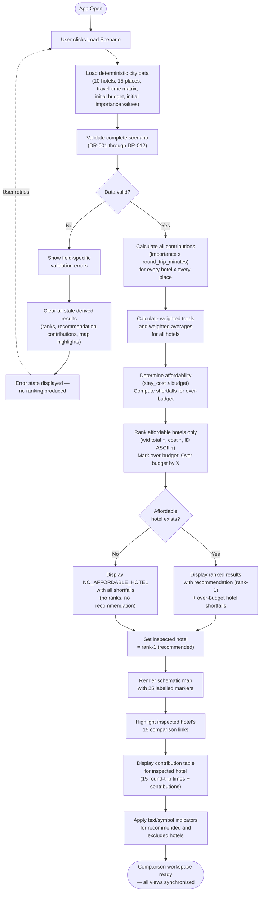
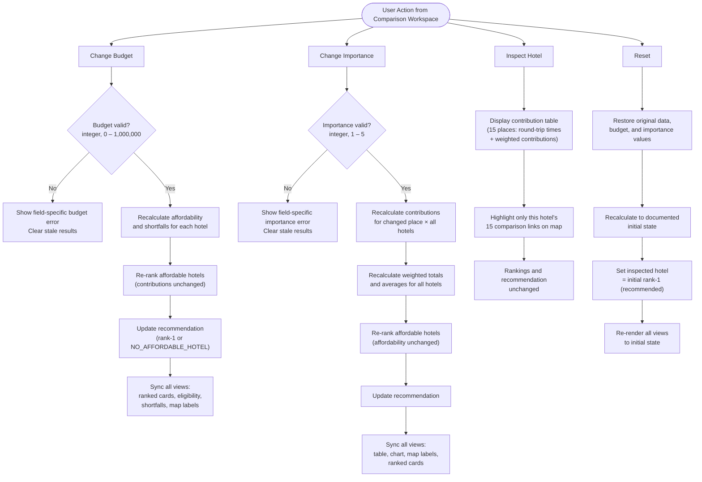

# USER_FLOWS.md — Hotel Base-Camp Comparator

## 1. Overview

This document contains two corrected user-flow diagrams for the Hotel Base-Camp Comparator, reviewed against every functional requirement (FR-001–FR-021), acceptance criterion (AC-001–AC-021), and relevant edge case. The original hand-drawn diagrams are preserved wherever they were correct; all changes are documented with requirement references in Section 5.

---

## 2. Flow 1 — Scenario Load & Initialisation

### 2.1 Original design (transcribed from Entire_Flow.jpeg)

```
App Open
  → User clicks Load
  → Load a deterministic City data
  → Validate entire new scenario
  → Data Valid?
      NO  → Show the exact validation errors that caused
          → Clear older results
          → Scenario doesn't load due to error in validation
          → (back to User clicks Load)
      YES → Calculate: contributions, wtd totals & averages
          → Check affordability and rank all hotels
          → Affordable hotel exists?
              YES → Display ranking & recommendation
              NO  → Display NO_AFFORDABLE_HOTELS
          → Open Comparison frontend
```

### 2.2 Review findings

| # | Original step | Verdict | Finding | Requirement |
|---|---|---|---|---|
| 1 | App Open → User clicks Load | ✅ Correct | Single button-click load — matches requirement. | FR-001, AC-001 |
| 2 | Load a deterministic City data | ✅ Correct | Deterministic data loading — matches requirement. | NFR-002, DR-015 |
| 3 | Validate entire new scenario | ✅ Correct | Complete-scenario validation before ranking — matches requirement. | FR-019, AC-015 |
| 4 | Data Valid? → NO → Show exact validation errors | ✅ Correct intent | Error identification is required. Wording refined to "field-specific" per clarification. | FR-020 |
| 5 | Clear older results | ✅ Correct | Clearing stale derived results is required. | FR-020 |
| 6 | Back to User clicks Load | ✅ Correct | Retry loop after failure is reasonable. | — |
| 7 | Calculate: contributions, wtd totals & averages | ✅ Correct | Matches the calculation pipeline. | FR-002, FR-003, FR-004 |
| 8 | Check affordability and rank all hotels | ⚠️ Wording | "Rank all hotels" should say "rank affordable hotels" — only affordable hotels receive ranks. Over-budget hotels are marked with shortfalls, not ranked. | FR-005, FR-006, FR-007, FR-008 |
| 9 | Affordable hotel exists? → YES → Display ranking & recommendation | ✅ Correct | Ranking and recommendation display. | FR-007 |
| 10 | Affordable hotel exists? → NO → Display NO_AFFORDABLE_HOTELS | ✅ Correct | Correct sentinel value. Shortfalls must be retained alongside it. | FR-009, AC-013 |
| 11 | Open Comparison frontend | ✅ Correct | Both paths converge to the workspace. | — |
| 12 | — | ❌ Missing | **Over-budget hotels visible with shortfalls** even when affordable hotels exist. Not shown as a separate step. | FR-008, AC-010 |
| 13 | — | ❌ Missing | **Set default inspected hotel = rank-1 (recommended).** No step for initialising the inspected hotel. | FR-012, FR-018, AC-017 |
| 14 | — | ❌ Missing | **Render schematic map with 25 labelled markers.** Map rendering is entirely absent from the load flow. | FR-014, AC-009 |
| 15 | — | ❌ Missing | **Highlight inspected hotel's 15 comparison links on the map.** | FR-015, AC-009 |
| 16 | — | ❌ Missing | **Display contribution table** for the inspected hotel (15 round-trip times + weighted contributions). | FR-013, FR-016 |
| 17 | — | ❌ Missing | **Apply text/symbol status indicators** (not colour alone) for recommended and excluded hotels. | FR-017 |

### 2.3 Corrected flow — narrative

1. **App Open** — application starts with an empty workspace and a visible "Load Scenario" button.
2. **User clicks "Load Scenario"** — single button-click action (FR-001).
3. **Load deterministic city data** — 10 hotels, 15 places, complete 10×15 travel-time matrix, initial budget, initial importance values (NFR-002, DR-014, DR-015).
4. **Validate complete scenario** — IDs, names, types, importance values, stay costs, budget, and travel-time mappings are validated against all data constraints (DR-001–DR-012). Validation covers the entire scenario atomically; partial ranking is never produced (FR-019).
5. **Data valid?**
   - **No →**
     - **Show field-specific validation errors** identifying the exact problem (FR-020).
     - **Clear all stale derived results** — ranks, recommendation, contributions, and map highlights are removed (FR-020).
     - **Error state displayed** — no ranking is produced. User can retry by clicking Load again.
   - **Yes →** continue to step 6.
6. **Calculate all contributions** — `importance × round_trip_minutes` for every hotel × every place (FR-002).
7. **Calculate weighted totals and weighted averages** for all hotels (FR-003, FR-004).
8. **Determine affordability** — `stay_cost ≤ budget` for each hotel (FR-005). Compute shortfall (`stay_cost − budget`) for over-budget hotels (FR-008).
9. **Rank affordable hotels** — sort by (1) exact weighted travel total ascending, (2) stay cost ascending, (3) hotel ID ASCII ascending. Assign consecutive ranks starting at 1. Over-budget hotels receive no rank and are marked "Over budget by X" (FR-006, FR-007, FR-008).
10. **Affordable hotel exists?**
    - **Yes →** Display ranked results with recommendation (rank-1) and over-budget shortfalls alongside (FR-007, FR-008, AC-010).
    - **No →** Display `NO_AFFORDABLE_HOTEL` with all shortfalls. No recommendation and no numerical ranks (FR-009, AC-013).
11. **Set default inspected hotel = rank-1** (initially recommended hotel). This selection is restored on every reset (FR-012, FR-018, AC-017).
12. **Render schematic map** with all 25 labelled markers (10 hotels + 15 places) (FR-014, AC-009, NFR-005).
13. **Highlight inspected hotel's 15 comparison links** on the map. Links represent comparisons, not routes (FR-015, AC-009, NFR-005).
14. **Display contribution table** for the inspected hotel — showing each of the 15 places' round-trip time and weighted contribution (FR-013, FR-016).
15. **Apply text/symbol status indicators** — recommended hotel and excluded (over-budget) hotels are identifiable without relying on colour alone (FR-017).
16. **Comparison workspace ready** — map, contribution table, ranked cards, eligibility reasons, and status indicators are all synchronised (FR-016).

### 2.4 Corrected flow — Mermaid diagram



---

## 3. Flow 2 — User Actions

### 3.1 Original design (transcribed from User_action_flows.jpeg)

```
User Action
  ├─ Change Budget
  │    → Recalculate affordability
  │    → Update rankings and recommendations!
  │
  ├─ Change Importance
  │    → Recalculate contributions
  │    → Recalculate wtd totals and average too
  │    → Update
  │
  ├─ Inspect a particular hotel
  │    → Display selected hotel's details
  │    → Highlight the 15 map connections
  │
  └─ Reset
       → Restore the original scenario
```

### 3.2 Review findings

#### Change Budget branch

| # | Original step | Verdict | Finding | Requirement |
|---|---|---|---|---|
| 1 | Change Budget → Recalculate affordability | ⚠️ Missing step before | **Validate budget first** — must be a whole number 0–1,000,000. If invalid, show field-specific error and clear stale results instead of recalculating. | DR-007, FR-021, EC-007 |
| 2 | Recalculate affordability | ✅ Correct | Affordability re-evaluation needed. | FR-005, FR-010 |
| 3 | Update rankings and recommendations | ✅ Correct | Rankings and recommendation update after affordability change. | FR-006, FR-007, FR-010 |
| 4 | — | ❌ Missing | **Contributions must remain unchanged** when only budget changes. Not stated but important constraint. | FR-010, EC-016 |
| 5 | — | ❌ Missing | **Recalculate shortfalls** ("Over budget by X") for over-budget hotels. | FR-008 |
| 6 | — | ❌ Missing | **Handle NO_AFFORDABLE_HOTEL** — if the new budget makes all hotels unaffordable, show the sentinel result. | FR-009, EC-012 |
| 7 | — | ❌ Missing | **Sync all views** — map link labels, contribution table, ranked cards, and eligibility reasons must all update. | FR-016 |

#### Change Importance branch

| # | Original step | Verdict | Finding | Requirement |
|---|---|---|---|---|
| 1 | Change Importance → Recalculate contributions | ⚠️ Missing step before | **Validate importance first** — must be a whole number 1–5. If invalid, show field-specific error and clear stale results. | DR-005, FR-021, EC-005 |
| 2 | Recalculate contributions | ✅ Correct | Affected contributions recalculated. | FR-002, FR-011 |
| 3 | Recalculate wtd totals and average too | ✅ Correct | Totals and averages depend on contributions. | FR-003, FR-004, FR-011 |
| 4 | Update | ⚠️ Too vague | **Must explicitly include**: re-rank affordable hotels (new weighted totals change sort order), update recommendation, update contribution table, update chart, update map link labels. | FR-006, FR-007, FR-011, FR-016 |
| 5 | — | ❌ Missing | **Affordability unchanged** — importance does not affect stay cost or budget, so affordability stays the same. Not stated but important to clarify. | FR-005 |

#### Inspect Hotel branch

| # | Original step | Verdict | Finding | Requirement |
|---|---|---|---|---|
| 1 | Inspect a particular hotel → Display selected hotel's details | ✅ Correct intent | Correct. Should explicitly note: display **contribution table with all 15 entries** (round-trip time + weighted contribution per place). | FR-012, FR-013 |
| 2 | Highlight the 15 map connections | ✅ Correct | Only the inspected hotel's 15 links are highlighted. | FR-015, AC-009 |
| 3 | — | ❌ Missing | **Rankings and recommendation must NOT change** when a different hotel is inspected. This invariant is not stated. | FR-012, EC-018 |

#### Reset branch

| # | Original step | Verdict | Finding | Requirement |
|---|---|---|---|---|
| 1 | Reset → Restore the original scenario | ✅ Correct intent | Correct direction but insufficiently detailed. Must restore **all** of the following: | FR-018, AC-017 |
| 2 | — | ❌ Missing | Restore original **budget**. | FR-018 |
| 3 | — | ❌ Missing | Restore original **importance values** for all places. | FR-018 |
| 4 | — | ❌ Missing | Restore **initial ranking and recommendation**. | FR-018, NFR-002 |
| 5 | — | ❌ Missing | Set **inspected hotel = initial rank-1** (recommended). | FR-018, AC-017 |
| 6 | — | ❌ Missing | **Re-render all views** (map, contribution table, ranked cards, eligibility) to the documented initial state. | FR-016, FR-018 |

### 3.3 Corrected flow — narrative

All four actions originate from the comparison workspace after a valid scenario is loaded.

#### Change Budget

1. User enters a new budget value.
2. **Validate budget** — must be a whole number (strict integer) in the range 0–1,000,000 (DR-007).
   - **Invalid →** Show field-specific error. Clear all stale derived results (ranks, recommendation, map highlights). No recalculation occurs (FR-020, FR-021).
   - **Valid →** Continue to step 3.
3. **Recalculate affordability** — re-evaluate `stay_cost ≤ budget` for every hotel. Compute shortfalls for over-budget hotels (FR-005, FR-008).
4. **Contributions remain unchanged** — importance values and travel times have not changed, so contributions, weighted totals, and averages stay the same (FR-010, EC-016).
5. **Re-rank affordable hotels** using existing weighted totals. Apply the same sort: (1) exact weighted total ↑, (2) stay cost ↑, (3) hotel ID ASCII ↑ (FR-006).
6. **Update recommendation** — new rank-1 hotel, or `NO_AFFORDABLE_HOTEL` if no hotel is affordable (FR-007, FR-009).
7. **Sync all views** — ranked cards, eligibility reasons, over-budget shortfalls, map link labels, and contribution table labels (FR-016). Inspected hotel does not change.

#### Change Importance

1. User changes a place's importance value.
2. **Validate importance** — must be a whole number (strict integer) in the range 1–5 (DR-005).
   - **Invalid →** Show field-specific error. Clear all stale derived results (FR-020, FR-021).
   - **Valid →** Continue to step 3.
3. **Recalculate affected contributions** — `importance × round_trip_minutes` for the changed place across all hotels (FR-002, FR-011).
4. **Recalculate weighted totals and averages** for all hotels (FR-003, FR-004).
5. **Affordability unchanged** — stay costs and budget are not affected by importance changes.
6. **Re-rank affordable hotels** using the new weighted totals (FR-006, FR-011).
7. **Update recommendation** — rank-1 may change due to new sort order (FR-007, AC-007).
8. **Sync all views** — contribution table, chart, map link labels, ranked cards, and eligibility reasons (FR-011, FR-016). Inspected hotel does not change.

#### Inspect Hotel

1. User selects a hotel to inspect (any hotel — affordable or over-budget).
2. **Display contribution table** for the inspected hotel — all 15 wishlist places with their round-trip time and weighted contribution (FR-013).
3. **Highlight only this hotel's 15 comparison links** on the schematic map. Previous hotel's links are removed (FR-015, AC-009).
4. **Rankings and recommendation remain unchanged** — inspection is a view-only action that does not alter the baseline result (FR-012, EC-018).

#### Reset

1. User clicks Reset.
2. **Restore all original scenario data** — hotels, places, travel-time matrix (NFR-002, DR-015).
3. **Restore original budget** (FR-018).
4. **Restore original importance values** for all 15 places (FR-018).
5. **Recalculate to initial state** — contributions, weighted totals, averages, affordability, ranking, and recommendation match the documented initial results (FR-018, AC-017).
6. **Set inspected hotel = initial rank-1** (initially recommended hotel) (FR-018, AC-017).
7. **Re-render all views to initial state** — map (25 markers, rank-1 hotel's 15 links highlighted), contribution table (rank-1 hotel), ranked cards, eligibility reasons, and status indicators (FR-016, FR-018).

### 3.4 Corrected flow — Mermaid diagram



---

## 4. Requirement coverage check

The table below confirms that every functional requirement and acceptance criterion is traceable to at least one flow step.

| Requirement | Flow 1 step | Flow 2 action | Covered? |
|---|---|---|---|
| FR-001 (load in one action) | Step 2 | — | ✅ |
| FR-002 (contributions) | Step 6 | Change Importance step 3 | ✅ |
| FR-003 (weighted totals) | Step 7 | Change Importance step 4 | ✅ |
| FR-004 (weighted averages) | Step 7 | Change Importance step 4 | ✅ |
| FR-005 (affordability) | Step 8 | Change Budget step 3 | ✅ |
| FR-006 (ranking sort) | Step 9 | Change Budget step 5, Change Importance step 6 | ✅ |
| FR-007 (consecutive ranks, rank-1) | Step 9, 10 | Change Budget step 6, Change Importance step 7 | ✅ |
| FR-008 (over-budget visible) | Step 8, 9 | Change Budget step 3 | ✅ |
| FR-009 (NO_AFFORDABLE_HOTEL) | Step 10 (No branch) | Change Budget step 6 | ✅ |
| FR-010 (budget change) | — | Change Budget (full branch) | ✅ |
| FR-011 (importance change) | — | Change Importance (full branch) | ✅ |
| FR-012 (inspect hotel) | Step 11 | Inspect Hotel step 4 | ✅ |
| FR-013 (15 place details) | Step 14 | Inspect Hotel step 2 | ✅ |
| FR-014 (25 markers) | Step 12 | — | ✅ |
| FR-015 (15 links highlighted) | Step 13 | Inspect Hotel step 3 | ✅ |
| FR-016 (view synchronisation) | Step 16 | All sync steps | ✅ |
| FR-017 (text/symbol indicators) | Step 15 | — | ✅ |
| FR-018 (reset) | — | Reset (full branch) | ✅ |
| FR-019 (validate before ranking) | Step 4 | — | ✅ |
| FR-020 (invalid clears stale) | Step 5 (No branch) | Budget/Importance invalid paths | ✅ |
| FR-021 (editable invalid demo) | — | Budget/Importance invalid paths | ✅ |
| AC-001–AC-008 | Steps 2–11 | Budget/Importance changes | ✅ |
| AC-009 (map details) | Steps 12–14 | Inspect Hotel | ✅ |
| AC-010 (costs/eligibility) | Steps 8–10, 15 | Change Budget | ✅ |
| AC-011 (budget boundary) | Step 8 | Change Budget step 3 | ✅ |
| AC-013 (no-affordable) | Step 10 (No) | Change Budget step 6 | ✅ |
| AC-014 (invalid rejected) | Step 5 (No) | Budget/Importance invalid | ✅ |
| AC-017 (reset restores) | — | Reset (full branch) | ✅ |

---

## 5. Change log

Every change from the original diagrams is listed below with the requirement it addresses and why it was necessary.

### 5.1 Flow 1 changes

| # | Change | Type | Requirement | Explanation |
|---|---|---|---|---|
| 1 | Refined "Show exact validation errors" → "Show **field-specific** validation errors" | Wording | FR-020 | Per clarification: errors must identify the exact field/problem, not just say "invalid data." |
| 2 | Changed "rank all hotels" → "rank **affordable** hotels only" | Correction | FR-006, FR-007, FR-008 | Only affordable hotels receive numerical ranks. Over-budget hotels are marked with shortfalls but not ranked. The original wording implied all hotels are ranked. |
| 3 | Added "Compute shortfalls for over-budget hotels" as part of the affordability step | Addition | FR-008, AC-010 | Over-budget hotels must show "Over budget by X" even when affordable hotels exist. The original flow only showed over-budget information in the NO_AFFORDABLE branch. |
| 4 | Added "Set inspected hotel = rank-1 (recommended)" after ranking | Addition | FR-012, FR-018, AC-017 | The default inspected hotel must be the initially recommended (rank-1) hotel. This was entirely missing from the original flow. |
| 5 | Added "Render schematic map with 25 labelled markers" | Addition | FR-014, AC-009, NFR-005 | Map rendering was absent from the original load flow. The map is a core part of the comparison workspace. |
| 6 | Added "Highlight inspected hotel's 15 comparison links" | Addition | FR-015, AC-009 | The inspected hotel's links must be highlighted on initial load, not only when the user explicitly inspects a hotel. |
| 7 | Added "Display contribution table for inspected hotel" | Addition | FR-013, FR-016 | The contribution table (15 round-trip times + weighted contributions) must be visible on load. This was entirely missing. |
| 8 | Added "Apply text/symbol indicators for recommended and excluded hotels" | Addition | FR-017 | Status must be conveyed through text or symbols in addition to colour. Not shown in the original flow. |
| 9 | Added "All views synchronised" to final state | Addition | FR-016 | The map, contribution table, ranked cards, and eligibility reasons must all be consistent. Not explicit in original. |

### 5.2 Flow 2 changes

| # | Change | Type | Requirement | Explanation |
|---|---|---|---|---|
| 1 | Added **budget validation** step before recalculation | Addition | DR-007, FR-021, EC-007 | Original went directly from "Change Budget" to "Recalculate affordability." Invalid budgets (non-integer, out of range) must be caught first and stale results cleared. |
| 2 | Added **importance validation** step before recalculation | Addition | DR-005, FR-021, EC-005 | Same pattern: importance must be validated (integer, 1–5) before contributions are recalculated. |
| 3 | Added "contributions unchanged" annotation to budget path | Addition | FR-010, EC-016 | Critical constraint: changing budget must NOT change contributions. The original flow didn't make this explicit. |
| 4 | Added "affordability unchanged" annotation to importance path | Addition | FR-005 | Clarifying that importance changes don't affect stay cost or budget, so affordability doesn't change. Only the ranking order changes via new weighted totals. |
| 5 | Added shortfall recalculation to budget path | Addition | FR-008 | "Over budget by X" amounts change when the budget changes. Not shown in original. |
| 6 | Added NO_AFFORDABLE_HOTEL handling to budget path | Addition | FR-009, EC-012 | If a budget reduction makes all hotels unaffordable, the sentinel result must appear. Not shown in original. |
| 7 | Expanded "Update" in importance path → "Re-rank, update recommendation, sync table/chart/map labels" | Clarification | FR-006, FR-011, FR-016 | The original "Update" box was too vague. Importance changes affect the sort order of weighted totals, so rankings and recommendation must be explicitly re-evaluated, and all views synchronised. |
| 8 | Expanded "Display selected hotel's details" → "Display contribution table with 15 entries (round-trip times + weighted contributions)" | Clarification | FR-013 | The original was vague about what "details" includes. FR-013 requires all 15 place-level values. |
| 9 | Added "Rankings and recommendation unchanged" to inspect path | Addition | FR-012, EC-018 | Critical invariant: inspecting a hotel must not alter the baseline ranking. Not stated in original. |
| 10 | Expanded "Restore the original scenario" → restore budget, importance, ranking, inspected hotel, re-render all views | Clarification | FR-018, AC-017 | The original was a single box. Reset must restore every editable value, the initial recommendation, and the default inspected hotel (rank-1). Each restored element is now an explicit step. |
| 11 | Added "Sync all views" to budget and importance paths | Addition | FR-016 | Map, contribution table, ranked cards, eligibility reasons, and chart must all update together. Not shown in original. |
